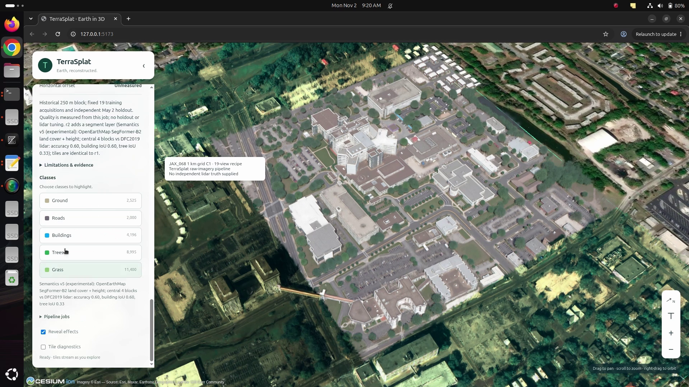
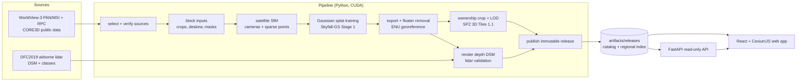

# TerraSplat

**Georeferenced 3D Gaussian-splat cities from satellite imagery, streamed to a web globe.**

TerraSplat turns multi-view satellite images into metric, geographically placed 3D Gaussian splats. It tiles them as
3D Tiles 1.1 (SPZ-compressed `KHR_gaussian_splatting`) and serves them to a CesiumJS web app through immutable,
hash-verified releases. Where independent airborne lidar is available, height errors are measured and published;
unmeasured areas are labelled. Experiments use pass/fail rules fixed before their results are seen.

> **Status (2026-11-02): research prototype.** A 1 km × 1 km area of Jacksonville, FL, built end to end from raw
> historical WorldView-3 imagery, is published as 16 trained blocks alongside 12 externally trained Skyfall-GS authors'
> scenes. Experimental v5 segmentation is complete for all 28 datasets in a separate review catalogue; the default
> catalogue still serves releases without segment layers. See [Results](#results) and [Limitations](#limitations).

[](https://www.youtube.com/watch?v=HKcTSGbMY7Q)

**[Watch the demo on YouTube](https://www.youtube.com/watch?v=HKcTSGbMY7Q)** — satellite imagery to streamed 3D
Gaussian splats, with semantic segmentation and interactive class highlighting.

---

## Contents

- [What it does](#what-it-does)
- [Architecture](#architecture)
- [Pipeline stages](#pipeline-stages)
- [Results](#results)
- [Getting started](#getting-started)
- [Running the pipeline](#running-the-pipeline)
- [Releases and API](#releases-and-api)
- [Web app](#web-app)
- [Semantics (segment mode)](#semantics-segment-mode)
- [Testing](#testing)
- [Engineering principles](#engineering-principles)
- [Repository layout](#repository-layout)
- [Limitations](#limitations)
- [Data sources and terms](#data-sources-and-terms)
- [Documentation](#documentation)

## What it does

| Capability | Details |
| --- | --- |
| **Satellite reconstruction** | Catalogues and crops WorldView-3 PAN/MSI imagery while keeping RPC camera geometry, runs satellite SfM, then trains Gaussian splats with the [Skyfall-GS](https://github.com/jayin92/Skyfall-GS) Stage 1 recipe on a 6 GB GPU. |
| **Geographic placement** | Each model is placed in a local ENU frame anchored to WGS84; transforms are verified by round trips and the output is checked against lidar. |
| **Tiled streaming** | Splats are cropped to an owned cell of a shared grid, merged into a LOD hierarchy (REPLACE refinement) and encoded as SPZ inside glTF in 3D Tiles 1.1. |
| **Immutable releases** | Releases are content-hashed and never overwritten; activation and rollback only move a catalogue pointer. A regional 3D Tiles index links all active blocks. |
| **Web globe** | React + Vite + CesiumJS 1.146 app: dataset and release selection, footprints, quality panels, reveal effects, GPU-aware quality profiles, segment mode. |
| **Semantic segmentation** | SegFormer-B2 trained on OpenEarthMap, multi-view projection and median fusion, height-based class rules, and per-tile labels. Selected classes receive animated holograms blended with their original colours. |
| **Resumable jobs** | One command runs a block from imagery selection to publication; every stage records its inputs, outputs and hashes and is reused only when nothing changed. |
| **Validation** | Registered DSM comparison with DFC2019 lidar (MAE per class), holdout PSNR, seam checks between neighbouring cells, and pre-registered pass/fail rules. |

## Architecture



An editable diagram is in [docs/architecture.drawio](docs/architecture.drawio).

## Pipeline stages

`pipeline.job` runs the stages below in order ([docs/JOBS.md](docs/JOBS.md)). GPU stages need an NVIDIA GPU;
`--no-gpu` stops before the first one.

| # | Stage | Module | What it produces |
| ---: | --- | --- | --- |
| 1 | `select` | `pipeline.acquisitions` | Offline scan of the catalogue and the approved train/holdout acquisitions |
| 2 | `sources` | `pipeline.sources` | Verified PAN/MSI cache (sizes, ETags, hashes) |
| 3 | `block_inputs` | `pipeline.block_inputs` | Sensor-pixel crops with RPCs, pansharpened RGB, masks |
| 4 | `satellite_sfm` | `pipeline.satellite_sfm` | Perspective camera approximation of each RPC ([SatelliteSfM](https://github.com/jayin92/SatelliteSfM)) |
| 5 | `reconstruct` | `pipeline.reconstruct` | Bundle-adjusted cameras and sparse points in ENU |
| 6 | `skyfall_inputs` | `pipeline.skyfall_inputs` | Training scene in the Skyfall-GS loader format |
| 7 | `input_check` | `scripts/check-skyfall-inputs.py` | Loader contract check |
| 8–9 | `cpu_preflight`, `gpu_preflight` | `pipeline.phase2` | Input and environment preflight reports |
| 10–11 | `training`, `evaluation` | `pipeline.training`, `pipeline.evaluation` | Trained splats, holdout PSNR |
| 12 | `export` | `pipeline.export` | Fused PLY in ENU; floater removal capped at 1 % of opacity mass |
| 13 | `render_depth` | `pipeline.render_depth` | Rendered-depth DSM points |
| 14 | `dsm_validation` | `pipeline.dsm_validation` | Registered MAE against lidar per class (if truth is supplied) |
| 15–16 | `tiling`, `encoding` | `pipeline.tiling`, `scripts/encode-tiles.mjs` | Owned-cell crop, LOD tree, SPZ glTF 3D Tiles |
| 17 | `publish` | `pipeline.publish` | Immutable release in a catalogue, optionally activated |

Supporting modules: `pipeline.grid_seams` and `pipeline.seam_check` (neighbouring cells), `pipeline.ownership` (shared
grid), `pipeline.skyfall_scenes` / `skyfall_final` (authors' scenes), `pipeline.semantics*` and `pipeline.segments`
(class layers), `pipeline.landcover_*` (land-cover model).

## Results

Measured on the Jacksonville JAX_068 area against the DFC2019 lidar DSM (registered MAE, i.e. surface shape). Full
tables, hashes and commands are in the linked documents.

| Result | Value | Source |
| --- | --- | --- |
| Single 250 m block, 19 views, authors' recipe | **1.36 m** MAE (ground 1.40, buildings 1.30, vegetation 1.53) | [TRAINING_FINDINGS](docs/TRAINING_FINDINGS.md) |
| Same block, first model (3 views, basic recipe) | 3.32 m MAE; more views and the authors' recipe brought it to 1.36 m | [TRAINING_FINDINGS](docs/TRAINING_FINDINGS.md) |
| 1 km grid (16 blocks, about 56 min per block on an RTX 3060 laptop GPU) | the 4 cells with lidar: 1.10–2.04 m, each within +0.16 m of a single-block model | [GRID_1KM_RESULT](docs/phase3/GRID_1KM_RESULT.md) |
| Grid seams | 2 of 4 pass; A2\|A3 and A2\|B2 fail (accepted as known issues) | [GRID_1KM_RESULT](docs/phase3/GRID_1KM_RESULT.md) |
| Semantics v5, authors' JAX_068 tuning scene | accuracy **0.724**, building IoU **0.690** (passes), tree IoU **0.366**; overall accuracy and tree IoU miss their targets | [SEMANTICS](docs/SEMANTICS.md) |
| Semantics v5, lidar-covered grid cells | accuracy **0.596**, building IoU **0.602**, tree IoU **0.334**; does not meet all targets | [SEMANTICS](docs/SEMANTICS.md) |

The default catalogue has 28 datasets: the 16 grid blocks (`jax068-2015-grid-*`) and 12 Skyfall-GS authors' scenes
(8 Jacksonville, 4 New York). The authors' finished models were trained externally; our integration places, tiles,
compresses, and serves them. They demonstrate higher-detail source-model delivery, not our own training quality.

The review catalogue contains segment layers for all 28 datasets, including all four NYC scenes (004, 010, 219,
336). Completion means the layers are generated and published for review; it does not establish accuracy on every scene.

## Getting started

### Requirements

| Component | Tested with |
| --- | --- |
| OS | Linux (Ubuntu) |
| GPU (training) | NVIDIA, 6 GB VRAM (RTX 3060 Laptop), CUDA 12.8 wheels; driver only, no system CUDA needed |
| Node.js | 22.12+ or 24+ |
| Python | 3.12 (pipeline, API, imagery); 3.10 (Skyfall-GS training) |
| Tools | `uv`, Git, GCC (to build the training extensions) |
| Disk | ≥ 20 GiB free per job stage; source imagery and models are several GB per block |

### Python environments

Heavy dependencies are kept apart; each environment is created by the setup steps in its document. Run Python with
`env -u PYTHONPATH` (or `export PYTHONPATH=`) if the host exports a `PYTHONPATH` (for example ROS).

| Environment | Used for | Setup |
| --- | --- | --- |
| `.venv-imagery` | Imagery, GDAL/Rasterio, lidar, semantics scoring | [imagery/README.md](imagery/README.md) |
| `.venv-sfm` | Satellite SfM, job runner, publisher | [sfm/README.md](sfm/README.md) |
| `.venv-stage1` | Skyfall-GS training, export, depth rendering (Python 3.10, PyTorch 2.7.1) | [training/README.md](training/README.md) |
| `.venv-api` | FastAPI release API | [services/api/README.md](services/api/README.md) |
| `.venv-landcover` | Land-cover model training and prediction | [docs/SEMANTICS.md](docs/SEMANTICS.md) |

### Run the web app on the published catalogue

```bash
npm ci
npm --prefix apps/web ci
npm run dev:app            # API on :8000, web app on http://127.0.0.1:5173
```

To view the experimental segment layers, serve the review catalogue:

```bash
TERRASPLAT_RELEASES_DIR=artifacts/releases-grid-review npm run dev:app
```

The default command serves `artifacts/releases`; review releases have not been promoted there.
`TERRASPLAT_RELEASES_DIR=<dir> npm run dev:app` serves another catalogue. On hybrid Intel/NVIDIA laptops, start
Chrome on the NVIDIA GPU for full quality ([apps/web/README.md](apps/web/README.md#running-chrome-on-the-nvidia-gpu-linux-hybrid-graphics-laptops)):

```bash
__NV_PRIME_RENDER_OFFLOAD=1 __VK_LAYER_NV_optimus=NVIDIA_only google-chrome \
  --user-data-dir=/tmp/chrome-nvidia --use-angle=vulkan \
  --enable-features=Vulkan,VulkanFromANGLE,DefaultANGLEVulkan http://127.0.0.1:5173/
```

## Running the pipeline

A job file describes one block: catalogue, approved acquisitions, training and tiling profiles, optional grid cell,
optional lidar truth, and release identity. Examples are in [configs/jobs](configs/jobs).

```bash
export PYTHONPATH=
.venv-sfm/bin/python -m pipeline.job configs/jobs/grid-1km-a1.json --dry-run    # print commands and reuse decisions
.venv-sfm/bin/python -m pipeline.job configs/jobs/grid-1km-a1.json --no-gpu     # CPU stages only
.venv-sfm/bin/python -m pipeline.job configs/jobs/grid-1km-a1.json              # full run (about 1 h of GPU)
.venv-sfm/bin/python -m pipeline.job configs/jobs/grid-1km-a1.json \
  --from publish --publish-to artifacts/releases --activate                     # publish to the live catalogue
```

- **Reuse:** rerunning the same command reuses every stage whose inputs, code and outputs still hash the same.
- **`--from <stage>`** forces that stage and everything after it; **`--until <stage>`** stops after it.
- **State:** `job-state.json` records each stage's command, environment, timing, log and hashes, written atomically
  under a job lock. Old attempts are kept.

## Releases and API

```text
artifacts/releases/
  catalog.json                       authoritative list of datasets, releases and active pointers
  index/<region>/tileset.json        3D Tiles index of active releases (external tilesets)
  <release_id>/release.json          manifest: provenance, footprint, quality, evidence, hashes
  <release_id>/tileset.json, tiles/  SPZ glTF 3D Tiles
```

```bash
.venv-sfm/bin/python -m pipeline.publish --config configs/releases/<id>.json --releases artifacts/releases [--activate]
.venv-sfm/bin/python -m pipeline.publish --releases artifacts/releases --activate-release <release_id>   # switch / roll back
.venv-sfm/bin/python -m pipeline.publish --releases artifacts/releases --retire-dataset <dataset_id>    # files kept in .withdrawn/
```

Release IDs are immutable; a rebuild needs a new ID. Manifests follow the JSON Schemas in [schemas/](schemas). The
read-only [API](services/api/README.md) serves datasets, releases, quality, footprints (GeoJSON) and the regional
index; OpenAPI docs are at `/docs`. Details: [docs/RELEASES.md](docs/RELEASES.md).

## Web app

[apps/web](apps/web/README.md) (React, Vite, TypeScript, CesiumJS 1.146):

- regional index with dataset and release selection, footprints and quality panels;
- level-of-detail control: full detail for the nearest blocks within 2 km, with hysteresis to stop LOD flipping;
- reveal effects: coarse tiles as points, leaves revealed by scan lines, parents held until the reveal ends
  ([docs/REVEAL_EFFECTS.md](docs/REVEAL_EFFECTS.md));
- GPU-aware quality profiles (integrated GPUs get a reduced profile; override with `?quality=full|reduced`);
- class selection: highlight splats from a per-release sidecar layer; buildings use TerraScope's blue holographic
  grid, scans and trails, blended at 20%–40% with the base colour (steady 30% with reduced motion or reduced quality)
  ([docs/SEGMENTS.md](docs/SEGMENTS.md));
- base imagery: bundled Natural Earth II plus Esri World Imagery (disable with `VITE_REMOTE_IMAGERY=false`); no
  Cesium ion services.

## Semantics (segment mode)

Segment mode labels splats as ground, road, building, trees, grass or water using a sidecar class layer (one byte per
splat), so geometry tiles stay byte-identical. With no classes selected, the scene keeps its original colours;
selected classes receive a holographic blend. The v5 model, projection/fusion pipeline, tile layers, and viewer are
implemented, but the classifier has not met all accuracy targets ([docs/SEMANTICS.md](docs/SEMANTICS.md)):

| Version | Method | Outcome |
| --- | --- | --- |
| v1 | NDVI (WorldView-3 multispectral), OpenStreetMap and height | failed 2 of 3 (accuracy 0.52, building IoU 0.70, tree IoU 0.19) |
| v2 | v1 with corrected class rules (diagnostic) | accuracy 0.68, building 0.70, tree 0.29; needs multispectral imagery, so not usable for RGB-only scenes |
| v3 | LangSplat SAM + CLIP features | failed (accuracy 0.25) |
| v4 | SAM + RemoteCLIP | failed (accuracy 0.47, building 0.31, tree 0.22) |
| **v5** | SegFormer-B2 trained on [OpenEarthMap](https://open-earth-map.org/) plus height | trained; JAX_068 accuracy 0.724, building IoU 0.690, tree IoU 0.366; building target passes, overall and tree targets fail |

The v5 model was trained using the Kaggle workflow, then applied to the training views of each scene. Pixel
probabilities are projected through the cameras with visibility checks, fused by median, combined with height rules,
and assigned to splats. The authors' scene layers cover the central 700 m square. Disk-backed, chunked fusion keeps
the 60-view NYC scenes from requiring the full probability stack in RAM; saved predictions can be fused on CPU.

All 16 grid blocks and 12 authors' scenes have v5 layers in `artifacts/releases-grid-review`. JAX_068 is the tuning
scene. A blind accuracy evaluation on the other seven DFC2019 Jacksonville scenes remains outstanding; generating
their layers is not an independent accuracy evaluation.

### Download the trained segmentation model

The training script and saved outputs are public on
[Kaggle: TerraSplat landcover v5](https://www.kaggle.com/code/npsbrar1986/terrasplat-landcover-v5).
Open the **Output** tab and select version **2**. The inference files are
`v5-oem-segformer-b2/best.safetensors` (about 105 MiB) and `v5-oem-segformer-b2/config.json`;
`report.json` records training and validation results. The best checkpoint was selected at step 36,000:
OpenEarthMap validation mIoU **0.680**, pixel accuracy **0.811**. These are image-space segmentation metrics, separate
from the projected 3D scene scores above.

With the Kaggle CLI installed and configured, download the version used by TerraSplat:

```bash
kaggle kernels output npsbrar1986/terrasplat-landcover-v5/2 \
  --file-pattern '^v5-oem-segformer-b2/(best\.safetensors|config\.json|report\.json)$' \
  -p artifacts/landcover/kaggle-v2
```

Checkpoint SHA-256: `c4967d6c7a71a42679c04ad164cb36b150450b30d1b9277cffb3cfc97fc0b15a`.
Use the downloaded directory with `pipeline.landcover_predict --model artifacts/landcover/kaggle-v2/v5-oem-segformer-b2`.
Weights stay outside Git. The model is documented for
non-commercial research/evaluation under its training-data terms; the repository's MIT code licence does not
relicense the weights or datasets.

## Testing

```bash
npm test && npm run test:browser                     # pilot viewer (Node test runner, Playwright)
npm run test:app                                     # web app unit + browser tests
PYTEST_DISABLE_PLUGIN_AUTOLOAD=1 .venv-sfm/bin/python -m pytest tests/sfm tests/python -q
PYTEST_DISABLE_PLUGIN_AUTOLOAD=1 .venv-imagery/bin/python -m pytest tests/imagery -q
PYTEST_DISABLE_PLUGIN_AUTOLOAD=1 .venv-api/bin/python -m pytest tests/api -q
PYTEST_DISABLE_PLUGIN_AUTOLOAD=1 .venv-landcover/bin/python -m pytest tests/landcover -q
```

All Python commands assume an empty `PYTHONPATH`.

## Engineering principles

- **Pre-registered decisions.** Thresholds and pass/fail rules (e.g. `configs/grid-1km-decision.json`,
  `configs/semantics-v*.json`) are committed before results exist and are never loosened afterwards; failures are
  recorded as failures.
- **Independent evidence.** Heights are checked against lidar the model never saw; holdout views are never used for
  training or for choosing settings; blind test scenes are not inspected until a method is fixed.
- **Provenance by hash.** Inputs, code, configs, outputs and releases are recorded by SHA-256; releases are immutable
  and every claim links to its evidence.
- **Measured, not assumed.** Missing measurements are null and labelled, never zero; quality numbers in releases come
  from the run that produced them.
- **Fits commodity hardware.** Training, export and tiling are tuned for a 6 GB laptop GPU.

## Repository layout

```text
pipeline/        Python pipeline modules (jobs, imagery, SfM, training, export, tiling, publishing, semantics)
scripts/         setup, environment checks, tile encoding (Node), helpers
configs/         block, training, tiling, release, job and decision configurations
apps/web/        React + Vite + CesiumJS web app
services/api/    FastAPI read-only release API
schemas/         JSON Schemas for release manifests and the catalogue
imagery/ sfm/ training/   stage documentation, pinned requirements and measured results
kaggle/          Kaggle notebook for land-cover training
tests/           pytest suites (per environment), Node and Playwright tests
docs/            plans, design notes and results
artifacts/       generated data, models and releases (not in Git)
```

## Limitations

- **Historical imagery:** the 19-view reconstruction uses October 2014–December 2015 acquisitions. We do not yet
  have a qualified recent multi-view imagery set; a current-city release needs suitable source images, camera
  metadata, and date-compatible validation.
- **Training hardware:** local training uses a 6 GB RTX 3060 Laptop GPU, resolution factor 2, a configured 200,000
  splat cap, and a 4.5 GiB allocated-tensor budget. Higher-resolution training and full Stage 2 refinement have not
  been demonstrated locally; larger-GPU trials are needed to measure their quality and memory trade-offs.
- **Limited validation coverage:** lidar comparisons cover JAX_068 and the four lidar-covered grid cells; the other
  12 grid cells are unmeasured. The lidar flight date is unknown, and there is no ground control.
- **Seams:** two seams of the 1 km grid exceed their thresholds, concentrated at cell A2's southern edge.
- **Skyfall scenes** are the authors' models, only visually registered (about 1.3–3.8 m); their heights are approximate.
- **Semantics** has not yet met its accuracy targets.
- **Rendering:** Gaussian splats are GPU-bound; integrated GPUs fall back to a reduced quality profile.

## Data sources and terms

| Data | Use | Terms |
| --- | --- | --- |
| [CORE3D public WorldView-3, Jacksonville](https://spacenet-dataset.s3.amazonaws.com/) (SpaceNet bucket, `Hosted-Datasets/CORE3D-Public-Data/`) | Training imagery | Per the dataset's terms |
| DFC2019 (Data Fusion Contest 2019) lidar DSM and classes | Validation only | Per the contest's terms |
| [Skyfall-GS datasets](https://huggingface.co/datasets/jayinnn/Skyfall-GS-datasets) | Authors' scenes, comparison | Apache-2.0 (dataset card) |
| [OpenEarthMap](https://open-earth-map.org/) | Land-cover training (v5) | Labels mostly CC BY-NC-SA 4.0: non-commercial |
| Esri World Imagery | Optional base map in the app | Esri terms; review before commercial use |

TerraSplat's original code is available under the [MIT License](LICENSE). Third-party code and dependencies retain
their own licences, including the upstream Gaussian-splatting research-use terms; MIT does not relicense those
components. Satellite imagery, datasets, pretrained and trained weights, and scene assets have separate source
and redistribution terms. They are not included in the Git repository or automatically licensed under MIT.

## Documentation

| Topic | Document |
| --- | --- |
| Current plan and open work | [docs/NEXT_STEPS.md](docs/NEXT_STEPS.md) |
| Architecture and build plan | [docs/PLAN.md](docs/PLAN.md), [docs/PLAN_V2.md](docs/PLAN_V2.md) |
| Job runner | [docs/JOBS.md](docs/JOBS.md) |
| Imagery | [imagery/README.md](imagery/README.md), [docs/IMAGERY_SPEC.md](docs/IMAGERY_SPEC.md) |
| Satellite SfM | [sfm/README.md](sfm/README.md) |
| Training environment and results | [training/README.md](training/README.md), [training/RESULT_2015.md](training/RESULT_2015.md), [docs/TRAINING_FINDINGS.md](docs/TRAINING_FINDINGS.md) |
| 1 km grid | [docs/phase3/GRID_1KM_PLAN.md](docs/phase3/GRID_1KM_PLAN.md), [docs/phase3/GRID_1KM_RESULT.md](docs/phase3/GRID_1KM_RESULT.md) |
| Releases, API, web app | [docs/RELEASES.md](docs/RELEASES.md), [services/api/README.md](services/api/README.md), [apps/web/README.md](apps/web/README.md) |
| Skyfall-GS scenes | [docs/SKYFALL_TILES.md](docs/SKYFALL_TILES.md) |
| Semantics and segment mode | [docs/SEMANTICS.md](docs/SEMANTICS.md), [docs/SEGMENTS.md](docs/SEGMENTS.md) |
| Viewer effects | [docs/REVEAL_EFFECTS.md](docs/REVEAL_EFFECTS.md) |
| Research notes | [docs/RESEARCH.md](docs/RESEARCH.md) |
| Early phases | [docs/PHASE0.md](docs/PHASE0.md), [docs/PHASE2.md](docs/PHASE2.md), [training/PILOT.md](training/PILOT.md) |
