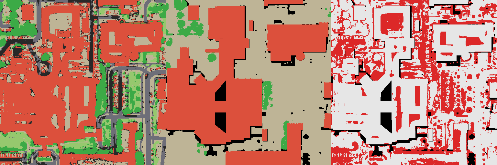
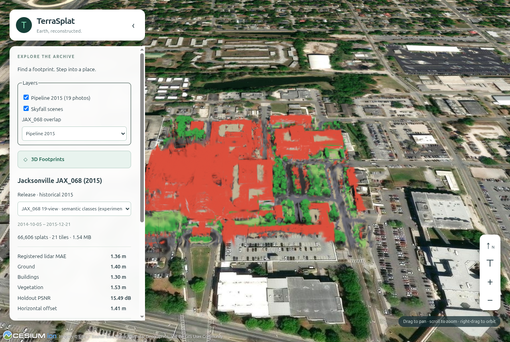

# Semantics (Phase 4.1)

`pipeline/semantics.py` labels every splat of a pipeline release as building, vegetation (trees), grass, road, water,
ground or unknown, and measures the labels against the DFC2019 JAX_068 class raster. Run with `.venv-imagery`:

```bash
.venv-imagery/bin/python -m pipeline.semantics --config configs/semantics-v2.json \
  --export artifacts/stage1/pilot-2015-19v-recipe-01/export-r2 \
  --points artifacts/validation/pilot-2015-19v-recipe-01-depth-r2/depth-points.npz \
  --truth artifacts/reference/dfc2019-jax068 --osm artifacts/reference/osm-jax068/osm.json \
  --imagery artifacts/imagery/pilot-19v/inputs --sources artifacts/imagery/pilot-19v/sources.json \
  --output artifacts/semantics/<new folder>
```

Outputs: `splat-classes.npz` (class per splat in fused-PLY order), `class-raster.tif`, `ndvi.tif`, `hag.tif`,
`evaluation.json` and `preview.png` (ours | DFC2019 | disagreement in red).

## Method

On the DFC2019 truth grid (UTM 17N, 0.5 m): the release's rendered-depth top surface; a ground estimate (5th percentile
in a 25.5 m window) and height above ground; top-of-atmosphere NDVI from WorldView-3 MSI red and NIR1 (absolute
calibration from each acquisition's MSI `.IMD`, Thuillier ESUN, earth–sun distance, sun elevation), sampled through the
RPCs of the three most nadir training views (median); OpenStreetMap buildings, water and highway buffers
(`artifacts/reference/osm-jax068`, snapshot 2026-10-30, ODbL, © OpenStreetMap contributors). Splats on the visible
surface take their cell's class; wall splats inside building footprints are buildings; hidden splats stay unknown.
Rules are fixed in the config before evaluation and scored strictly (unknown counts as wrong).

## Results on JAX_068 (19-view release)

| | v1 (pre-registered) | v2 (diagnostic, not independent) | Target |
| --- | ---: | ---: | ---: |
| Overall accuracy | 0.519 | 0.683 | ≥ 0.80 |
| Building IoU | 0.702 | 0.702 | ≥ 0.60 |
| Vegetation (tree) IoU | 0.192 | 0.292 | ≥ 0.50 |
| Unknown cells | 21 % | 10 % | |

**v1 fails two of three targets.** NDVI itself works (median 0.64 on DFC trees, 0.03 on buildings, 0.07 on ground).
The failures come from (1) a class definition: DFC2019 class 5 is *high* vegetation, and lawns are ground, so v1's
"NDVI ≥ 0.30 is vegetation" scored 33,817 lawn cells as errors; and (2) model height noise: true ground sits a median
1.8 m above the ground estimate, so v1's 1 m "low" band left many ground cells unknown.

**v2** (`configs/semantics-v2.json`) splits vegetation at 2 m into trees and grass and widens the low band to 2 m. Both
changes were chosen after seeing v1's errors here, so its JAX_068 score is a diagnostic. It still misses two targets:
trees are found (recall 0.86) but over-predicted (precision 0.31), because the model's noisy heights lift green lawns
above 2 m; and 21,660 cells are tall, non-green and unmapped, mostly height noise rather than buildings.



Building labels are usable now (IoU 0.70, precision and recall about 0.82). Vegetation and ground are limited by the
model's geometry more than by the rules; next options are a height-independent tree cue (e.g. NDVI texture or the
RedEdge band) and an independent test once class labels for another area are available.

## Viewing classes in the app (Phase 4.2, first version)

`pipeline/semantic_colours.py` writes a copy of an export whose splat colours are the class colours (geometry,
opacity and order unchanged; unknown splats keep their own colour in greyscale). It is tiled with the release's own
tile profile and published as a second, inactive release of the same dataset:
`jax068-2015-19v-classes-r1`, "JAX_068 19-view · semantic classes (experimental)". Choose it in the release dropdown;
the panel shows a colour legend. Coarse levels average the class colours of merged splats.


