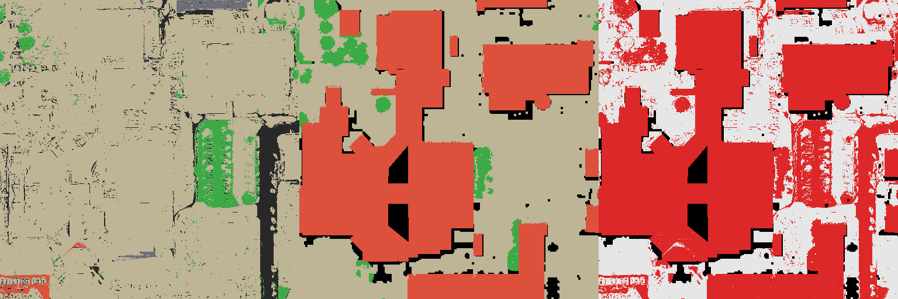
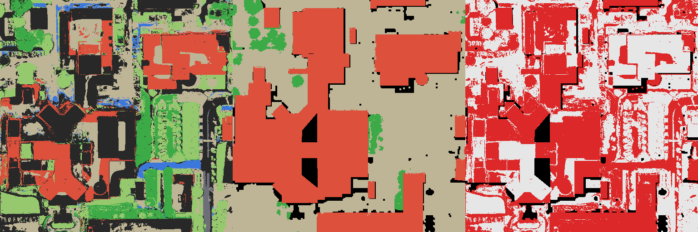

# Semantics (Phase 4.1)

`pipeline/semantics.py` labels every splat of a pipeline release as building, vegetation (trees), grass, road, water,
ground or unknown, and measures the labels against the DFC2019 JAX_068 class raster. Run with `.venv-imagery`:

```bash
.venv-imagery/bin/python -m pipeline.semantics --config configs/semantics-v2.json \
  --export artifacts/stage1/pilot-2015-19v-recipe-01/export-r2 \
  --points artifacts/validation/pilot-2015-19v-recipe-01-depth-r2/depth-points.npz \
  --truth artifacts/reference/dfc2019-jax068 --osm artifacts/reference/osm-jax068/osm.json \
  --imagery artifacts/imagery/pilot-19v/inputs --sources artifacts/imagery/pilot-19v/sources.json \
  --output artifacts/semantics/<new folder>
```

Outputs: `splat-classes.npz` (class per splat in fused-PLY order), `class-raster.tif`, `ndvi.tif`, `hag.tif`,
`evaluation.json` and `preview.png` (ours | DFC2019 | disagreement in red).

## Method

On the DFC2019 truth grid (UTM 17N, 0.5 m): the release's rendered-depth top surface; a ground estimate (5th percentile
in a 25.5 m window) and height above ground; top-of-atmosphere NDVI from WorldView-3 MSI red and NIR1 (absolute
calibration from each acquisition's MSI `.IMD`, Thuillier ESUN, earth–sun distance, sun elevation), sampled through the
RPCs of the three most nadir training views (median); OpenStreetMap buildings, water and highway buffers
(`artifacts/reference/osm-jax068`, snapshot 2026-10-30, ODbL, © OpenStreetMap contributors). Splats on the visible
surface take their cell's class; wall splats inside building footprints are buildings; hidden splats stay unknown.
Rules are fixed in the config before evaluation and scored strictly (unknown counts as wrong).

## Results on JAX_068 (19-view release)

| | v1 (pre-registered) | v2 (diagnostic, not independent) | Target |
| --- | ---: | ---: | ---: |
| Overall accuracy | 0.519 | 0.683 | ≥ 0.80 |
| Building IoU | 0.702 | 0.702 | ≥ 0.60 |
| Vegetation (tree) IoU | 0.192 | 0.292 | ≥ 0.50 |
| Unknown cells | 21 % | 10 % | |

**v1 fails two of three targets.** NDVI itself works (median 0.64 on DFC trees, 0.03 on buildings, 0.07 on ground).
The failures come from (1) a class definition: DFC2019 class 5 is *high* vegetation, and lawns are ground, so v1's
"NDVI ≥ 0.30 is vegetation" scored 33,817 lawn cells as errors; and (2) model height noise: true ground sits a median
1.8 m above the ground estimate, so v1's 1 m "low" band left many ground cells unknown.

**v2** (`configs/semantics-v2.json`) splits vegetation at 2 m into trees and grass and widens the low band to 2 m. Both
changes were chosen after seeing v1's errors here, so its JAX_068 score is a diagnostic. It still misses two targets:
trees are found (recall 0.86) but over-predicted (precision 0.31), because the model's noisy heights lift green lawns
above 2 m; and 21,660 cells are tall, non-green and unmapped, mostly height noise rather than buildings.


Building labels are usable now (IoU 0.70, precision and recall about 0.82). Vegetation and ground are limited by the
model's geometry more than by the rules; next options are a height-independent tree cue (e.g. NDVI texture or the
RedEdge band) and an independent test once class labels for another area are available.

## Viewing classes in the app (Phase 4.2, first version)

`pipeline/semantic_colours.py` writes a copy of an export whose splat colours are the class colours (geometry,
opacity and order unchanged; unknown splats keep their own colour in greyscale). It is tiled with the release's own
tile profile and published as a second, inactive release of the same dataset:
`jax068-2015-19v-classes-r1`, "JAX_068 19-view · semantic classes (experimental)". Choose it in the release dropdown;
the panel shows a colour legend. Coarse levels average the class colours of merged splats.


## v3: LangSplat SAM + CLIP features (failed)

`pipeline/semantics_clip.py` (`configs/semantics-v3.json`, committed in `c3fc76f` before scoring) tests whether
LangSplat's open-vocabulary image features can replace NDVI and OpenStreetMap. LangSplat's `preprocess.py` (repo on the
data drive, `Tools-For-References-Map/LangSplat`; SAM ViT-B + OpenCLIP ViT-B-16 laion2b, the earlier pilot's quality
settings) segments each of the 19 training views (10.5 min on the RTX 3060 laptop GPU, 3.4 GB peak). Nine prompt
classes (`scripts/clip-prototypes.py`) score every segment; each truth-grid cell's top-surface point is projected
through the bundle-adjusted training cameras with a z-buffer occlusion test, and per-view probabilities are fused by
median. Trees and grass are decided by CLIP alone; height only separates raised from flat surfaces.

The projection itself is verified: a grey orthophoto sampled through all 19 cameras agrees with each view (correlation
0.75–0.96, falling to 0.54–0.72 when shifted 3 m).

| | v3 (pre-registered) | CLIP only (diagnostic) | Target |
| --- | ---: | ---: | ---: |
| Overall accuracy | 0.251 | 0.399 | ≥ 0.80 |
| Building IoU | 0.001 | 0.001 | ≥ 0.60 |
| Vegetation (tree) IoU | 0.067 | 0.067 | ≥ 0.50 |

**v3 fails all three targets.** The "shadow" class won 93 % of cells (226,534 of 243,691): general-purpose CLIP sees
the masked segments of 0.3 m overhead crops as dark, shaded texture. The underlying signal is weak even without that
sink: the building score separates DFC buildings from everything else with AUC 0.76, the tree score DFC trees with AUC
0.75, and dropping the shadow class (a post-hoc diagnostic) gives 0.15 accuracy. For comparison, NDVI alone gives trees
a median of 0.64 against 0.03 on buildings.



Conclusion: LangSplat's standard CLIP features (trained on ground-level photos) do not classify overhead satellite
views of this block. Running LangSplat's 3D feature training on top would distil the same features, so it cannot
fix this. v2 (NDVI + OSM + height) remains the class layer in the app.

## v4: RemoteCLIP features on the authors' JAX_068 model (failed)

`configs/semantics-v4.json` (fixed before scoring) keeps v3's method and swaps the CLIP for RemoteCLIP ViT-L-14
(remote-sensing image-text pairs), with remote-sensing prompts, no shadow or car class, and the Skyfall-GS authors'
JAX_068 model (17 training views, lidar offset removed). Features: 12 min on the RTX 3060 laptop GPU, 2.8 GB peak.
Two LangSplat fixes were needed to run it; neither changes features of images that ran before: CLIP waits on the CPU
while SAM runs (ViT-L CLIP and SAM did not fit 6 GB together), and a SAM level with no masks in any crop is skipped
instead of crashing (`safe_preprocess.py`, LangSplat repo).

| | v3 | v4 (pre-registered) | v4 CLIP only (diagnostic) | Target |
| --- | ---: | ---: | ---: | ---: |
| Overall accuracy | 0.251 | 0.471 | 0.539 | ≥ 0.80 |
| Building IoU | 0.001 | 0.311 | 0.371 | ≥ 0.60 |
| Vegetation (tree) IoU | 0.067 | 0.225 | 0.225 | ≥ 0.50 |

**v4 fails all three targets**, though every score is well above v3. Evidence from `artifacts/semantics/v4-jax068`:

- **"Soil" is the new sink.** CLIP called 100,772 of 246,916 cells bare soil (v3: shadow 93 %). On raised surfaces soil
  becomes unknown, so most roofs end up unknown: of 112,889 DFC building cells, 35,840 are building, 52,546 unknown
  and 21,598 ground. Building precision is 0.94; recall is 0.32.
- **Trees are over-called**: recall 0.57 but precision 0.27 (12,706 DFC ground cells called trees).
- **Water is false**: 6,999 cells (shaded road edges), and DFC has none in this block.
- Height costs accuracy here (0.471 against 0.539 CLIP only): roofs the model places lower than 2.5 m become ground.



Conclusion: remote-sensing CLIP reads overhead views much better than general CLIP, but zero-shot prompt scoring of
SAM segments is still far from the targets. Next is v5 (docs/NEXT_STEPS.md): a land-cover segmentation model trained
on sub-metre imagery, plus height.

## v5 training: OpenEarthMap land cover

`pipeline/landcover_train.py` trains an eight-class SegFormer on OpenEarthMap RGB images. This stage only trains
and predicts image probabilities; projection and scoring on JAX_068 are future work. No v5 results are claimed.

Use the existing `.venv-landcover` (torch 2.7.1+cu128, torchvision 0.22.1, transformers 4.53.3, rasterio 1.4.4,
safetensors, numpy, pytest). Always unset `PYTHONPATH` to avoid ROS imports. No packages or weights are downloaded
by these scripts. Before training, place the `nvidia/mit-b2` Hugging Face `config.json` and `pytorch_model.bin`
in `artifacts/landcover/pretrained/mit-b2`, or set `pretrained_dir` to another local directory. Torch >= 2.6 reads
the bin weights with `weights_only=True`; trained model weights are saved only as safetensors.

Review `configs/landcover-v5-train.json` before the GPU run. Defaults: 512-pixel crops, ImageNet normalisation,
random horizontal/vertical flips and quarter turns, AdamW (lr 6e-5, weight decay 0.01), 40,000 optimiser steps,
linear warmup for 1,500 steps from 1e-6 of the base lr, then polynomial decay (power 1). Batch size 8 without
accumulation (SegFormer's standard ADE20K batch); validation every 4,000 steps. These are proposed starting settings, not measured memory
or accuracy results. On the RTX 3060 laptop's 6 GB, lower `batch_size` if needed and adjust `accumulation` to
retain the effective batch. Training uses fp16 autocast and GradScaler on CUDA; validation also uses fp16
inference. The validation window batch is separately configurable. Split files are relative to `data_root`;
other config paths are relative to the working directory. Test images are unused.

```bash
env -u PYTHONPATH .venv-landcover/bin/python -m pipeline.landcover_train \
  --config configs/landcover-v5-train.json
# Optional short run; resume to the configured total without changing the schedule:
env -u PYTHONPATH .venv-landcover/bin/python -m pipeline.landcover_train \
  --config configs/landcover-v5-train.json --max-steps 2
env -u PYTHONPATH .venv-landcover/bin/python -m pipeline.landcover_train \
  --config configs/landcover-v5-train.json --resume
```

Use either a full run or the short-run/resume sequence with a new output directory. `--max-steps` is an absolute
stop step. The default output is `artifacts/landcover/v5-oem-segformer-b2`: `best.safetensors` selected by validation
mIoU, `last.safetensors` plus `last.pt` (optimiser, scaler, step, RNG and report), model `config.json`,
`train-log.jsonl` and `report.json`. Resume requires the same config and restores the last checkpoint; a finished
output directory is never overwritten. The report records split counts (including missing xBD images), per-class
IoU, mIoU over classes with nonzero union, valid-pixel accuracy, digests and software versions. Code 0 is ignored;
output channels 0..7 correspond to OpenEarthMap codes 1..8: bareland, rangeland, developed space, road, tree, water,
agriculture land, building. Classes absent from both truth and predictions have null IoU.

```bash
env -u PYTHONPATH .venv-landcover/bin/python -m pipeline.landcover_predict \
  --model artifacts/landcover/v5-oem-segformer-b2 --images /path/to/images --output /path/to/new-probs
```

Prediction writes float16 `(H, W, 8)` `<name>_probs.npy` arrays and a digest report. Validation reuses the same
512-pixel sliding windows, 128-pixel overlap and smooth blending; horizontal flip TTA is optional and off by default.
CPU tests use synthetic TIFFs and a tiny random SegFormer without downloads:

```bash
env -u PYTHONPATH PYTEST_DISABLE_PLUGIN_AUTOLOAD=1 .venv-landcover/bin/python -m pytest tests/landcover -q
```
