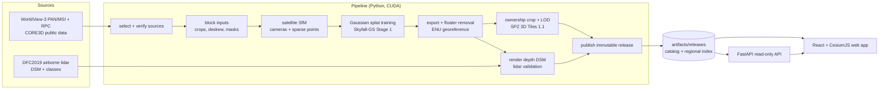

# Technical overview

[Project home](../README.md) · [All documentation](README.md)

The implementation, measured results, and limitations behind TerraSplat. Run commands from the repository root.

## What it does

| Capability | Details |
| --- | --- |
| **Satellite reconstruction** | Catalogues and crops WorldView-3 PAN/MSI imagery while keeping RPC camera geometry, runs satellite SfM, then trains Gaussian splats with the [Skyfall-GS](https://github.com/jayin92/Skyfall-GS) Stage 1 recipe on a 6 GB GPU. |
| **Geographic placement** | Each model is placed in a local ENU frame anchored to WGS84; transforms are verified by round trips and the output is checked against lidar. |
| **Tiled streaming** | Splats are cropped to an owned cell of a shared grid, merged into a LOD hierarchy (REPLACE refinement) and encoded as SPZ inside glTF in 3D Tiles 1.1. |
| **Immutable releases** | Releases are content-hashed and never overwritten; activation and rollback only move a catalogue pointer. A regional 3D Tiles index links all active blocks. |
| **Web globe** | React + Vite + CesiumJS 1.146 app: dataset and release selection, footprints, quality panels, reveal effects, GPU-aware quality profiles, segment mode. |
| **Semantic segmentation** | SegFormer-B2 trained on OpenEarthMap, multi-view projection and median fusion, height-based class rules, and per-tile labels. Selected classes receive animated holograms blended with their original colours. |
| **Resumable jobs** | One command runs a block from imagery selection to publication; every stage records its inputs, outputs and hashes and is reused only when nothing changed. |
| **Validation** | Registered DSM comparison with DFC2019 lidar (MAE per class), holdout PSNR, seam checks between neighbouring cells, and pre-registered pass/fail rules. |

## Architecture



An editable diagram is in [docs/architecture.drawio](architecture.drawio).

## Pipeline stages

`pipeline.job` runs the stages below in order ([docs/JOBS.md](JOBS.md)). GPU stages need an NVIDIA GPU;
`--no-gpu` stops before the first one.

| # | Stage | Module | What it produces |
| ---: | --- | --- | --- |
| 1 | `select` | `pipeline.acquisitions` | Offline scan of the catalogue and the approved train/holdout acquisitions |
| 2 | `sources` | `pipeline.sources` | Verified PAN/MSI cache (sizes, ETags, hashes) |
| 3 | `block_inputs` | `pipeline.block_inputs` | Sensor-pixel crops with RPCs, pansharpened RGB, masks |
| 4 | `satellite_sfm` | `pipeline.satellite_sfm` | Perspective camera approximation of each RPC ([SatelliteSfM](https://github.com/jayin92/SatelliteSfM)) |
| 5 | `reconstruct` | `pipeline.reconstruct` | Bundle-adjusted cameras and sparse points in ENU |
| 6 | `skyfall_inputs` | `pipeline.skyfall_inputs` | Training scene in the Skyfall-GS loader format |
| 7 | `input_check` | `scripts/check-skyfall-inputs.py` | Loader contract check |
| 8–9 | `cpu_preflight`, `gpu_preflight` | `pipeline.phase2` | Input and environment preflight reports |
| 10–11 | `training`, `evaluation` | `pipeline.training`, `pipeline.evaluation` | Trained splats, holdout PSNR |
| 12 | `export` | `pipeline.export` | Fused PLY in ENU; floater removal capped at 1 % of opacity mass |
| 13 | `render_depth` | `pipeline.render_depth` | Rendered-depth DSM points |
| 14 | `dsm_validation` | `pipeline.dsm_validation` | Registered MAE against lidar per class (if truth is supplied) |
| 15–16 | `tiling`, `encoding` | `pipeline.tiling`, `scripts/encode-tiles.mjs` | Owned-cell crop, LOD tree, SPZ glTF 3D Tiles |
| 17 | `publish` | `pipeline.publish` | Immutable release in a catalogue, optionally activated |

Supporting modules: `pipeline.grid_seams` and `pipeline.seam_check` (neighbouring cells), `pipeline.ownership` (shared
grid), `pipeline.skyfall_scenes` / `skyfall_final` (authors' scenes), `pipeline.semantics*` and `pipeline.segments`
(class layers), `pipeline.landcover_*` (land-cover model).

## Results

Measured on the Jacksonville JAX_068 area against the DFC2019 lidar DSM (registered MAE, i.e. surface shape). Full
tables, hashes and commands are in the linked documents.

| Result | Value | Source |
| --- | --- | --- |
| Single 250 m block, 19 views, authors' recipe | **1.36 m** MAE (ground 1.40, buildings 1.30, vegetation 1.53) | [TRAINING_FINDINGS](TRAINING_FINDINGS.md) |
| Same block, first model (3 views, basic recipe) | 3.32 m MAE; more views and the authors' recipe brought it to 1.36 m | [TRAINING_FINDINGS](TRAINING_FINDINGS.md) |
| 1 km grid (16 blocks, about 56 min per block on an RTX 3060 laptop GPU) | the 4 cells with lidar: 1.10–2.04 m, each within +0.16 m of a single-block model | [GRID_1KM_RESULT](phase3/GRID_1KM_RESULT.md) |
| Grid seams | 2 of 4 pass; A2\|A3 and A2\|B2 fail (accepted as known issues) | [GRID_1KM_RESULT](phase3/GRID_1KM_RESULT.md) |
| Semantics v5, authors' JAX_068 tuning scene | accuracy **0.724**, building IoU **0.690** (passes), tree IoU **0.366**; overall accuracy and tree IoU miss their targets | [SEMANTICS](SEMANTICS.md) |
| Semantics v5, lidar-covered grid cells | accuracy **0.596**, building IoU **0.602**, tree IoU **0.334**; does not meet all targets | [SEMANTICS](SEMANTICS.md) |

The default catalogue has 28 datasets: the 16 grid blocks (`jax068-2015-grid-*`) and 12 Skyfall-GS authors' scenes
(8 Jacksonville, 4 New York). The authors' finished models were trained externally; our integration places, tiles,
compresses, and serves them. They demonstrate higher-detail source-model delivery, not our own training quality.

The review catalogue contains segment layers for all 28 datasets, including all four NYC scenes (004, 010, 219,
336). Completion means the layers are generated and published for review; it does not establish accuracy on every scene.

## Engineering principles

- **Pre-registered decisions.** Thresholds and pass/fail rules (e.g. `configs/grid-1km-decision.json`,
  `configs/semantics-v*.json`) are committed before results exist and are never loosened afterwards; failures are
  recorded as failures.
- **Independent evidence.** Heights are checked against lidar the model never saw; holdout views are never used for
  training or for choosing settings; blind test scenes are not inspected until a method is fixed.
- **Provenance by hash.** Inputs, code, configs, outputs and releases are recorded by SHA-256; releases are immutable
  and every claim links to its evidence.
- **Measured, not assumed.** Missing measurements are null and labelled, never zero; quality numbers in releases come
  from the run that produced them.
- **Fits commodity hardware.** Training, export and tiling are tuned for a 6 GB laptop GPU.

## Repository layout

```text
pipeline/        Python pipeline modules (jobs, imagery, SfM, training, export, tiling, publishing, semantics)
scripts/         setup, environment checks, tile encoding (Node), helpers
configs/         block, training, tiling, release, job and decision configurations
apps/web/        React + Vite + CesiumJS web app
services/api/    FastAPI read-only release API
schemas/         JSON Schemas for release manifests and the catalogue
imagery/ sfm/ training/   stage documentation, pinned requirements and measured results
kaggle/          Kaggle notebook for land-cover training
tests/           pytest suites (per environment), Node and Playwright tests
docs/            plans, design notes and results
artifacts/       generated data, models and releases (not in Git)
```

## Limitations

- **Historical imagery:** the 19-view reconstruction uses October 2014–December 2015 acquisitions. We do not yet
  have a qualified recent multi-view imagery set; a current-city release needs suitable source images, camera
  metadata, and date-compatible validation.
- **Training hardware:** local training uses a 6 GB RTX 3060 Laptop GPU, resolution factor 2, a configured 200,000
  splat cap, and a 4.5 GiB allocated-tensor budget. Higher-resolution training and full Stage 2 refinement have not
  been demonstrated locally; larger-GPU trials are needed to measure their quality and memory trade-offs.
- **Limited validation coverage:** lidar comparisons cover JAX_068 and the four lidar-covered grid cells; the other
  12 grid cells are unmeasured. The lidar flight date is unknown, and there is no ground control.
- **Seams:** two seams of the 1 km grid exceed their thresholds, concentrated at cell A2's southern edge.
- **Skyfall scenes** are the authors' models, only visually registered (about 1.3–3.8 m); their heights are approximate.
- **Semantics** has not yet met its accuracy targets.
- **Rendering:** Gaussian splats are GPU-bound; integrated GPUs fall back to a reduced quality profile.

## Data sources and terms

| Data | Use | Terms |
| --- | --- | --- |
| [CORE3D public WorldView-3, Jacksonville](https://spacenet-dataset.s3.amazonaws.com/) (SpaceNet bucket, `Hosted-Datasets/CORE3D-Public-Data/`) | Training imagery | Per the dataset's terms |
| DFC2019 (Data Fusion Contest 2019) lidar DSM and classes | Validation only | Per the contest's terms |
| [Skyfall-GS datasets](https://huggingface.co/datasets/jayinnn/Skyfall-GS-datasets) | Authors' scenes, comparison | Apache-2.0 (dataset card) |
| [OpenEarthMap](https://open-earth-map.org/) | Land-cover training (v5) | Labels mostly CC BY-NC-SA 4.0: non-commercial |
| Esri World Imagery | Optional base map in the app | Esri terms; review before commercial use |

TerraSplat's original code is available under the [MIT License](../LICENSE). Third-party code and dependencies retain
their own licences, including the upstream Gaussian-splatting research-use terms; MIT does not relicense those
components. Satellite imagery, datasets, pretrained and trained weights, and scene assets have separate source
and redistribution terms. They are not included in the Git repository or automatically licensed under MIT.
